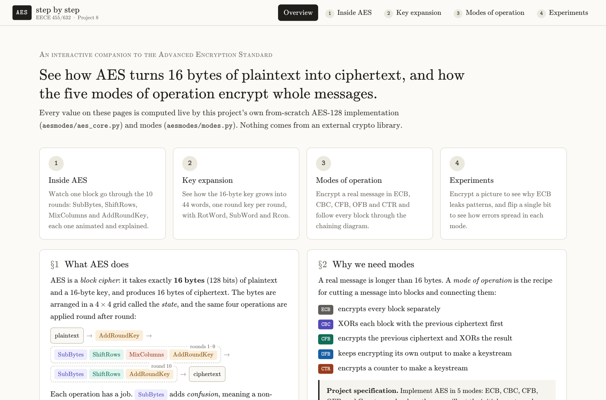
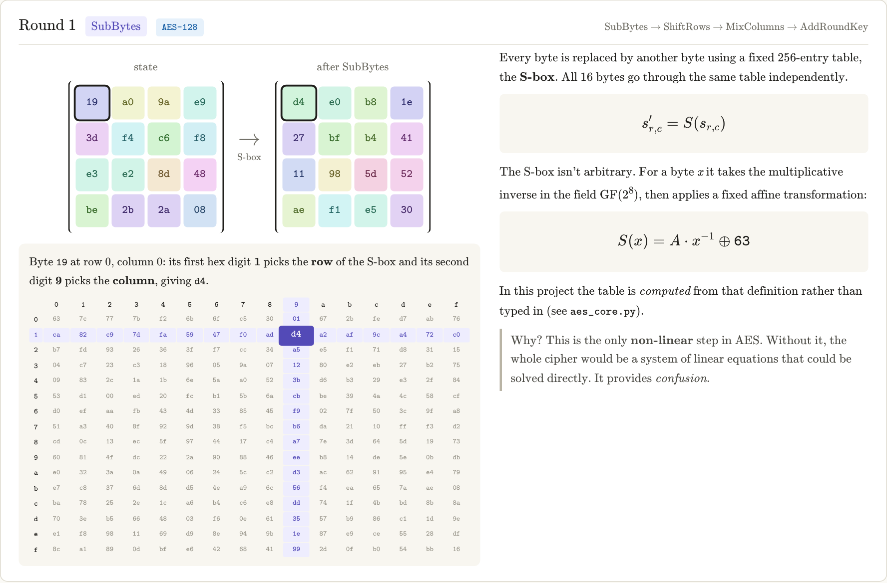
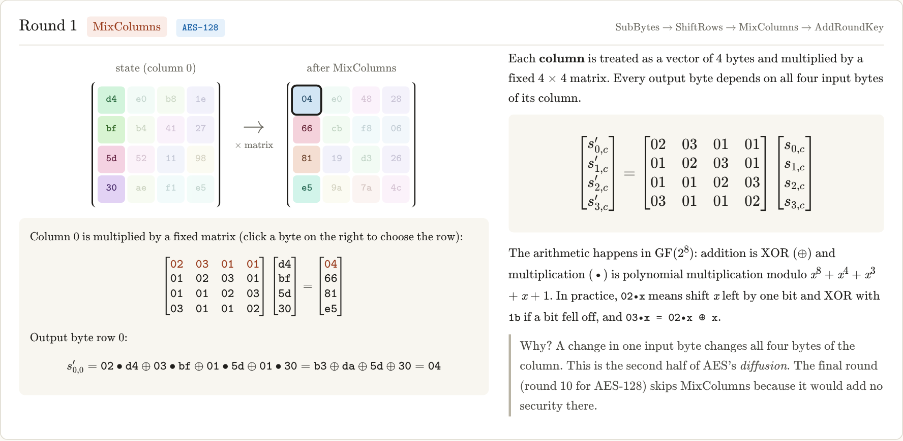
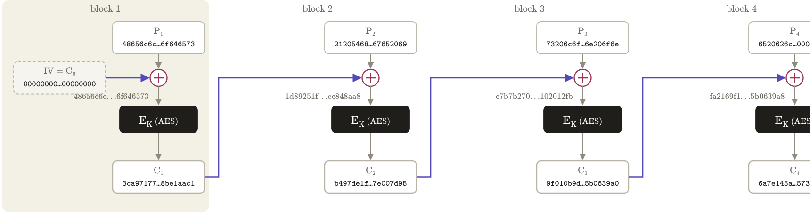
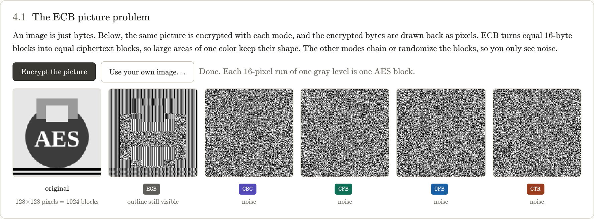
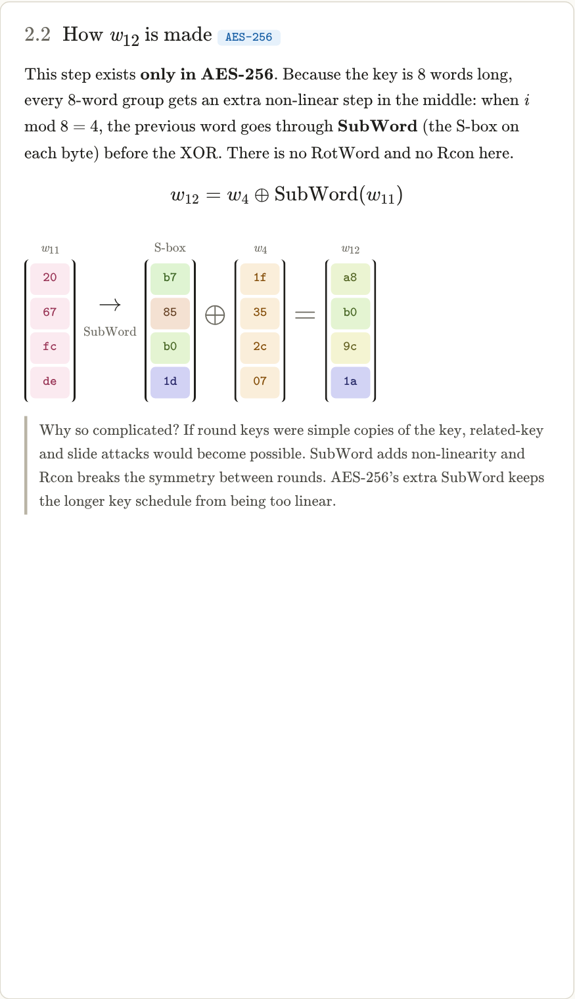

# AES Modes of Operation

**EECE 455/632 – Cryptography and Network Security · Project 8**

[](https://github.com/aes-modes-project/aes-modes-of-operation/actions/workflows/pages.yml)

### ▶ Open the learning app: **[aes-modes-project.github.io/aes-modes-of-operation](https://aes-modes-project.github.io/aes-modes-of-operation/)**

### 🔒 Use it: the AES Encryptor: **[aes-modes-project.github.io/aes-modes-of-operation/encryptor](https://aes-modes-project.github.io/aes-modes-of-operation/encryptor/)**

No installation needed: both sites run the project's own Python code directly in your browser.

An educational implementation of **AES** (with **128-, 192- and 256-bit keys**) written from scratch in Python, together with its five
classic **modes of operation**: ECB, CBC, CFB, OFB and Counter (CTR). It comes with an interactive
**learning app** with a LaTeX-inspired look. It animates every step of AES (SubBytes, ShiftRows,
MixColumns, AddRoundKey, key expansion), draws each mode block by block with real values, and includes
experiments such as the famous "ECB picture".



> ⚠️ **Educational use only.** This project follows the course specification (for example, an
> all-zero IV), which is deliberately predictable so results can be checked by hand. Do not use it to
> protect real data; use a vetted library such as `cryptography` or `pycryptodome` instead.

---

## Project specification

> *Implement AES in 5 modes: ECB, CBC, CFB, OFB, and Counter mode where the user will set the initial
> counter value (padding of last block should be done with zeroes along with count of pad size;
> Initial vectors should be set to zeroes).*

| Requirement | How it is implemented |
|---|---|
| Block cipher | AES-128, AES-192 and AES-256 (FIPS-197), implemented from scratch: no crypto library is used for encryption |
| Modes | ECB, CBC, CFB, OFB, CTR |
| Initial vector | 16 zero bytes (`00…00`) for CBC, CFB and OFB |
| Counter | 128-bit initial value entered by the user, incremented by 1 per block (mod 2¹²⁸) |
| Padding | Zero bytes, last byte = number of padding bytes (ANSI X.923 style), see [docs/padding.md](docs/padding.md) |

## Roadmap

- [x] **Step 1 – AES-128 core**: key expansion, round operations, encrypt/decrypt one block, step trace
- [x] **Step 2 – Padding**: zeros + pad-count byte
- [x] **Step 3 – ECB mode**
- [x] **Step 4 – CBC mode**
- [x] **Step 5 – CFB mode** (full-block, CFB-128)
- [x] **Step 6 – OFB mode**
- [x] **Step 7 – CTR mode** (user-defined initial counter)
- [x] **Step 8 – Learning app**: AES step-by-step visualizer, key expansion, mode diagrams, experiments ([docs](docs/web-app.md))
- [x] **Step 9 – AES-192 and AES-256**: all three key sizes in the core, all five modes and the learning app
- [x] **Step 10 – Web version**: the learning app online on GitHub Pages, with tests run on every push
- [x] **Step 11 – AES Encryptor**: a separate website that encrypts real files and messages with any mode and key size ([docs](docs/encryptor.md))
- [ ] **Step 12 – Report material**: mode comparison ([done](docs/modes-comparison.md)), ECB-pattern and error-propagation demos (in the app), written report

## Repository structure

```
aes-modes-of-operation/
├── aesmodes/              # the Python package
│   ├── __init__.py
│   ├── __main__.py        # command-line demo (python -m aesmodes)
│   ├── aes_core.py        # AES block cipher, 128/192/256-bit keys (one 16-byte block)
│   ├── padding.py         # zeros + pad-count padding
│   ├── modes.py           # ECB, CBC, CFB, OFB, CTR
│   ├── explain.py         # step-by-step data for the learning app
│   ├── api.py             # request handlers, shared by the local server and the web version
│   ├── fastaes.py         # table-based AES (same results, ~7x faster) for real files
│   ├── filecrypt.py       # file/message encryptor: streaming modes, passwords, HMAC, .aesm format
│   └── web/
│       ├── server.py      # the learning app's Flask server (python -m aesmodes.web)
│       ├── static/        # the learning app: index.html, css/, js/, vendor/katex/
│       └── encryptor/     # the AES Encryptor website: index.html, app.js, worker.js, style.css
├── tests/
│   ├── test_aes_core.py   # FIPS-197 test vectors + random cross-checks
│   ├── test_padding.py
│   ├── test_ecb.py        # ECB: NIST SP 800-38A F.1.1
│   ├── test_modes.py      # CBC/CFB/OFB/CTR: NIST vectors, error propagation
│   ├── test_key_sizes.py  # AES-192/256: FIPS-197 + NIST vectors for every mode
│   ├── test_web.py        # the learning app's server
│   ├── test_api_and_site.py  # shared handlers + building the web version
│   └── test_filecrypt.py  # FastAES, streaming modes, .aesm containers, command line
├── docs/
│   ├── aes-core.md        # how the AES core is built
│   ├── padding.md         # the padding scheme
│   ├── ecb.md             # one page per mode ...
│   ├── cbc.md
│   ├── cfb.md
│   ├── ofb.md
│   ├── ctr.md
│   ├── modes-comparison.md   # all five modes side by side
│   ├── web-app.md         # how the learning app works
│   ├── encryptor.md       # how the AES Encryptor works + the .aesm format
│   └── images/            # screenshots
├── tools/
│   └── build_site.py      # builds the web version (GitHub Pages)
├── .github/workflows/
│   └── pages.yml          # on every push: run the tests, then publish the web version
├── CHANGELOG.md           # what changed in each step
├── requirements.txt       # runtime dependencies
├── requirements-dev.txt   # testing dependencies
├── pyproject.toml         # project metadata + pytest configuration
├── .gitignore
├── LICENSE
└── README.md
```

## Getting started

Requires **Python 3.10+**.

```bash
# 1. Create and activate a virtual environment
python3 -m venv .venv
source .venv/bin/activate          # Windows: .venv\Scripts\activate

# 2. Install dependencies (Flask for the app, pytest + pycryptodome for the tests)
pip install -r requirements-dev.txt

# 3. Run the tests
python -m pytest -v

# 4. Start the learning app (opens http://127.0.0.1:8455 in your browser)
python -m aesmodes.web

# 5. Or use the command line: AES key schedule + round-by-round trace
python -m aesmodes

# 6. Encrypt a message in all five modes, block by block
python -m aesmodes modes "Hello, AES modes!"
python -m aesmodes modes "Hello" --key 000102030405060708090a0b0c0d0e0f --counter ff
```

In VS Code: open the folder, press `⇧⌘P` → **Python: Select Interpreter** → choose `.venv`, then
use the **Testing** sidebar to run the tests.

## The learning app

There are two ways to open it, and both run the same code:

- **Online:** **https://aes-modes-project.github.io/aes-modes-of-operation/**. GitHub publishes it automatically after every push to `main`, once the
  tests pass. The browser loads Python (Pyodide) and runs the project's own `aesmodes/*.py` files,
  so no server is needed. The first visit takes a few seconds to load.
- **On your computer:** `python -m aesmodes.web` starts a local Python server at
  http://127.0.0.1:8455. This also works offline, for example during a presentation.

| Section | What it teaches |
|---|---|
| **1 · Inside AES** | Step through every state of one block (41, 49 or 57 for AES-128/192/256): S-box lookup, animated ShiftRows, MixColumns matrix maths in GF(2⁸), bit-level AddRoundKey |
| **2 · Key expansion** | How each of the 44, 52 or 60 key words is built (RotWord, SubWord, Rcon, and AES-256's extra SubWord) |
| **3 · Modes of operation** | Encrypt or decrypt any message; see the padding byte by byte and a block diagram with every real value |
| **4 · Experiments** | The ECB picture, flipping one ciphertext bit, what a zero IV leaks, comparison table |

| | |
|---|---|
|  |  |
|  |  |
|  | |

Every value is computed by the Python code in `aesmodes/`. The browser only draws. See
[docs/web-app.md](docs/web-app.md) for how it works.

## The AES Encryptor

A second website, built as an **application** of the five modes:
**https://aes-modes-project.github.io/aes-modes-of-operation/encryptor/**

- Encrypt a **message** (you get a text token to paste anywhere) or a **file** up to 25 MB (you get `name.aesm`).
- Choose **ECB, CBC, CFB, OFB or CTR**, and **AES-128, 192 or 256**.
- Use a **password** (stretched with PBKDF2-HMAC-SHA256) or a **hex key** (with a Generate button).
- IV: all zeros as in the specification, or random. CTR: your own initial counter, or a random one.
- Decrypting needs only the password or key: the mode, key size and IV/counter are stored in the file.
- An HMAC-SHA256 tag detects a wrong password or any changed byte.

Everything happens in your browser: nothing is uploaded. The same format works on the command line:

```bash
python -m aesmodes.filecrypt encrypt report.pdf --mode CTR --bits 256      # asks for a password
python -m aesmodes.filecrypt decrypt report.pdf.aesm
```

See [docs/encryptor.md](docs/encryptor.md) for the file format and how it works.

## Usage (library)

Every key field in the app has an **AES-128 / AES-192 / AES-256** selector.

```python
from aesmodes import AES, format_state

aes = AES(bytes.fromhex("000102030405060708090a0b0c0d0e0f"))   # 16, 24 or 32 bytes

trace = []                                     # optional: collect every intermediate state
ct = aes.encrypt_block(bytes.fromhex("00112233445566778899aabbccddeeff"), trace)
print(ct.hex())                                # 69c4e0d86a7b0430d8cdb78070b4c55a

for step in trace[:3]:
    print(step["round"], step["step"])
    print(format_state(step["state"]))
```

### Encrypting a message with a mode

```python
from aesmodes import encrypt, decrypt

key = bytes.fromhex("2b7e151628aed2a6abf7158809cf4f3c")   # or a 24- / 32-byte key for AES-192 / AES-256

res = encrypt("CBC", key, b"Hello, AES modes!")         # zero IV, zero+count padding
print(res.hex())                                        # 32 bytes: 17 + 15 padding
for s in res.steps:                                     # what happened to each block
    print(s.index, s.note)
    print("   in ", s.block_in.hex(), " xor ", s.xor_with.hex())
    print("   AES", s.aes_input.hex(), "->", s.aes_output.hex())
    print("   out", s.block_out.hex())

print(decrypt("CBC", key, res.output).output)           # b'Hello, AES modes!'

# CTR mode: the user chooses the initial counter (hex string, int or 16 bytes)
ct = encrypt("CTR", key, b"Hello", counter="f0f1f2f3f4f5f6f7f8f9fafbfcfdfeff").output
print(decrypt("CTR", key, ct, counter="f0f1f2f3f4f5f6f7f8f9fafbfcfdfeff").output)
```

Each mode also has its own functions (`cbc_encrypt`, `ctr_decrypt`, …). `ModeResult` holds the
output, the padded data, the IV or counter used, and one `BlockStep` per block.

## Verification

The AES core is checked against the official **FIPS-197** test vectors for all three key sizes (key
expansion A.1–A.3, Appendix B, and C.1–C.3) and against `pycryptodome` on hundreds of random keys
and blocks.

All five modes are checked against the **NIST SP 800-38A** test vectors (F.1.1, F.2.1, F.3.13, F.4.1,
F.5.1), against `pycryptodome` with the zero IV, with round trips for many message lengths, and with
error-propagation tests that confirm the behaviour described in
[docs/modes-comparison.md](docs/modes-comparison.md). AES-192 and AES-256 are also checked against the NIST SP 800-38A vectors in every mode.
Run `python -m pytest -v` to see all 214 tests. GitHub runs them too, on every push.

## References

- NIST **FIPS-197**, *Advanced Encryption Standard (AES)*
- NIST **SP 800-38A**, *Recommendation for Block Cipher Modes of Operation*
- W. Stallings, *Cryptography and Network Security: Principles and Practice*

## License

MIT, see [LICENSE](LICENSE).
