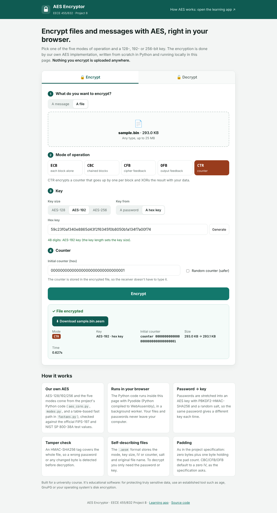
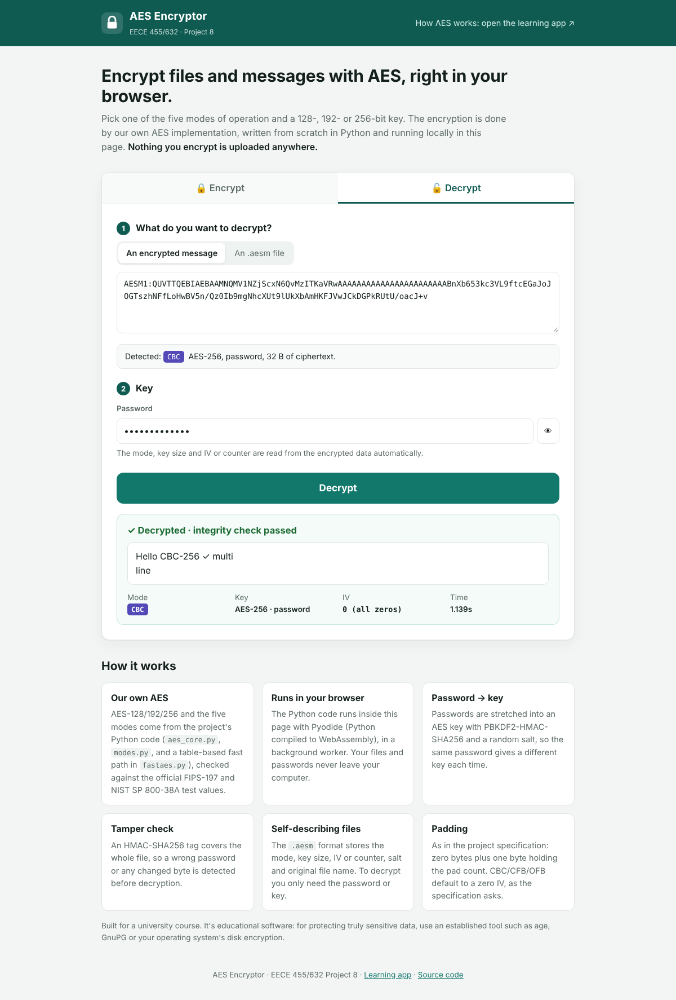

# The AES Encryptor

**Live:** https://aes-modes-project.github.io/aes-modes-of-operation/encryptor/

The learning app shows *how* AES and the modes work. The Encryptor is an *application* of them: a
small, separate website where you can encrypt real messages and files with the project's own AES,
in any of the five modes and with any key size.

| Encrypting a file | Decrypting a message |
|---|---|
|  |  |

## Using it

1. **What to encrypt:** a message (typed) or a file (up to 25 MB, any type).
2. **Mode:** ECB, CBC, CFB, OFB or CTR. The page explains each one; ECB shows a warning because
   identical blocks give identical ciphertext.
3. **Key:** AES-128, 192 or 256, from a **password** or a **hex key** (32, 48 or 64 hex digits;
   *Generate* makes a random one).
4. **IV / counter:** CBC, CFB and OFB use an all-zero IV, as the project specification asks, or a
   random IV. CTR takes the initial counter you type (default `…01`) or a random one.
5. **Encrypt.** A message becomes a text token starting with `AESM1:` that you can paste in a chat or
   email. A file becomes `name.aesm`.

To decrypt, paste the token or drop the `.aesm` file. The page reads the header, shows the detected
mode and key size, and asks only for the password or key.

## How it works

```
 page (app.js) ──postMessage──▶  Web Worker (worker.js)
   buttons, file drop,             Pyodide = Python in WebAssembly
   progress bar, downloads         runs aesmodes/filecrypt.py
                                     ├─ fastaes.py   (AES rounds)
                                     ├─ modes.py     (counter helpers, mode names)
                                     └─ padding.py   (zeros + pad-count byte)
```

* **Same Python code.** The worker loads the project's own `aesmodes/*.py` files, so the website, the
  command line and the tests all run identical code. Nothing is sent to a server.
* **Web Worker.** Encryption runs in a background thread, so the page stays responsive and can show
  progress while a large file is processed.
* **FastAES** (`fastaes.py`). The teaching `AES` class computes every step separately so the learning
  app can display it. It takes about 7 s per MB. `FastAES` merges SubBytes, ShiftRows and MixColumns
  into four 256-entry lookup tables (*T-tables*). The tables are built from our own S-box and GF(2⁸)
  multiplication, so the AES itself is still ours. The tests check that it gives exactly the same
  output as `AES` (FIPS-197 vectors plus thousands of random blocks).
* **Streaming modes** (`filecrypt.ModeStream`). They work like `modes.py` but keep only the chaining
  value (previous ciphertext block, OFB register or counter), so data can be processed in chunks.
  The tests check that the output is byte-for-byte equal to `modes.py`.
* **Passwords → keys.** PBKDF2-HMAC-SHA256 with 200,000 iterations and a random 16-byte salt gives the
  AES key plus a separate 32-byte MAC key. Because the salt is random, the same password gives a
  different key every time.
* **Integrity.** None of the five modes notices a wrong key or a changed ciphertext on its own: they
  just output garbage. An HMAC-SHA256 tag over the whole container (*encrypt-then-MAC*) is checked
  before decrypting, so the page can say "wrong password, or the file was changed".

## The `.aesm` format

All integers are big-endian.

| Offset | Size | Field |
|---|---|---|
| 0 | 4 | magic `AESM` |
| 4 | 1 | version (1) |
| 5 | 1 | mode: 0 ECB, 1 CBC, 2 CFB, 3 OFB, 4 CTR |
| 6 | 1 | key length in bytes (16, 24, 32) |
| 7 | 1 | key source: 0 hex key, 1 password |
| 8 | 1 | flags: bit 0 = IV/counter chosen by the user or zero |
| 9 | 4 | PBKDF2 iterations (0 for a hex key) |
| 13 | 16 | salt |
| 29 | 16 | IV (CBC/CFB/OFB) or initial counter (CTR) |
| 45 | 2 | file-name length *n* |
| 47 | *n* | original file name (UTF-8) |
| 47+*n* | … | ciphertext, padded with zeros + pad-count byte |
| end−32 | 32 | HMAC-SHA256 of everything before it |

A text token is `AESM1:` followed by the base64 of the same container.

## Command line

```bash
python -m aesmodes.filecrypt encrypt photo.jpg --mode CBC --bits 256          # password prompt
python -m aesmodes.filecrypt encrypt photo.jpg --mode CTR --key 000102…1f --counter 00…01
python -m aesmodes.filecrypt decrypt photo.jpg.aesm -o photo-copy.jpg
```

Files encrypted on the website decrypt on the command line and the other way round (tested).

## Limits

This is educational software. It is correct and tested, but it is not audited and it is written in
pure Python. For truly sensitive data, use an established tool (age, GnuPG, your OS disk encryption).
The zero-IV option is there because the specification asks for it. With a zero IV, the same message
and key always give the same ciphertext.
