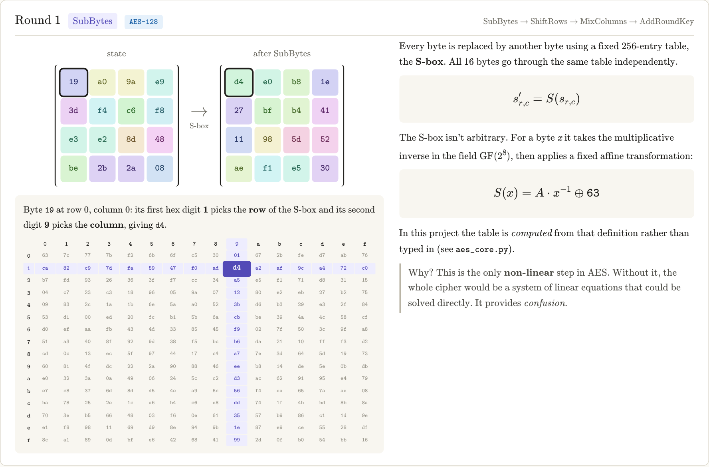
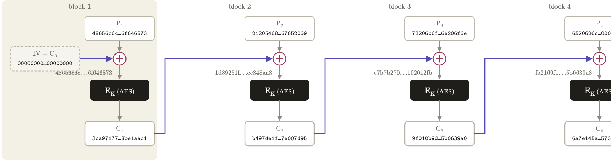
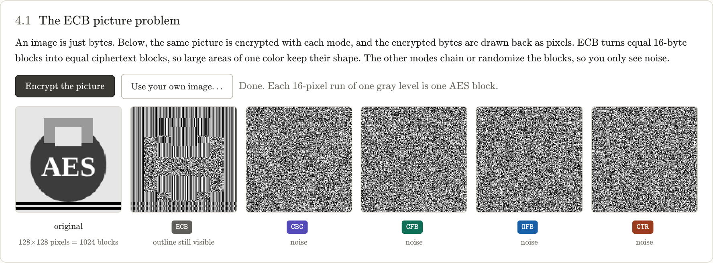

# The learning app

Folder: [`aesmodes/web/`](../aesmodes/web/) · Online at **https://nourkhatib22.github.io/aes-modes-of-operation/** · Locally: `python -m aesmodes.web`

The app is a local web page that **teaches** AES and its modes visually. It runs on your own computer:
a small Python server (Flask) calls the project's AES and modes code, and your browser draws the
results. No cryptography is done in JavaScript. Every number on screen comes from
`aesmodes/aes_core.py` and `aesmodes/modes.py`.

```
 browser (static/)                      Python (aesmodes/)
 ┌──────────────────────────┐  JSON   ┌───────────────────────────────┐
 │ index.html, css, js      │ ──────► │ web/server.py   (Flask routes)│
 │ draws matrices, diagrams │ ◄────── │ explain.py      (step data)   │
 │ KaTeX for the formulas   │         │ aes_core.py, modes.py, padding│
 └──────────────────────────┘         └───────────────────────────────┘
```

## Two ways to run it

| | Online (GitHub Pages) | Local |
|---|---|---|
| How to open | https://nourkhatib22.github.io/aes-modes-of-operation/ | `python -m aesmodes.web` → http://127.0.0.1:8455 |
| Where the Python runs | in your browser, with [Pyodide](https://pyodide.org) (Python compiled to WebAssembly) | in the Flask server on your computer |
| Needs installing | nothing | Python + `pip install -r requirements.txt` |
| Works offline | no | yes |
| Updated | automatically after every push to `main` | when you pull the latest code |

Both versions use the **same request handlers** (`aesmodes/api.py`), which call the same AES and
modes code, so they always give identical results. When the page loads, it tries `api/version`. If a
local server answers, it uses the server; otherwise it loads Pyodide and the files
`aesmodes/{__init__,aes_core,padding,modes,explain,api}.py`, and runs them in the browser. The footer
shows which one is in use.

### How the online version is published

`.github/workflows/pages.yml` runs on every push to `main`:

1. **test**: installs `requirements-dev.txt` and runs all tests. If any test fails, nothing is published.
2. **deploy**: downloads Pyodide with `npm pack pyodide@0.26.4`, runs
   `python tools/build_site.py --pyodide <folder>`, and publishes the resulting `_site/` folder to GitHub
   Pages.

One-time setup (already done for this repo): **Settings → Pages → Build and deployment → Source: GitHub
Actions**.

To build the web version yourself: download Pyodide (`npm pack pyodide@0.26.4 && tar xzf pyodide-*.tgz`),
then run `python tools/build_site.py --pyodide package` and serve `_site/` with any web server, for
example `python -m http.server -d _site`.

## Running it locally

```bash
source .venv/bin/activate
pip install -r requirements.txt       # installs Flask
python -m aesmodes.web                # opens http://127.0.0.1:8455
```

Options: `--port 9000` to use another port, `--no-browser` to not open the browser automatically.
Stop it with **Ctrl+C**. The default port 8455 avoids port 5000, which macOS uses for AirPlay.

## The four sections

### 1 · Inside AES
Every key field has an **AES-128 / AES-192 / AES-256** selector. Choosing a size loads an example key
of that length, and you can also type any key of 32, 48 or 64 hex digits.

Encrypts one 16-byte block and lets you step through every intermediate state (**41, 49 or 57** for
AES-128, AES-192 or AES-256; buttons, the
timeline, the slider, or the ← → keys; space plays and pauses). Each operation has its own visual and
explanation:

| Operation | What you see |
|---|---|
| Input | the 16 bytes filling the 4×4 state column by column (hover to match bytes to cells) |
| SubBytes | before/after matrices and the full S-box with the looked-up row, column and result highlighted |
| ShiftRows | an animation of the rows rotating left by 0, 1, 2 and 3 places |
| MixColumns | the matrix multiplication for the chosen column, and the GF(2⁸) products for the chosen output byte |
| AddRoundKey | state ⊕ round key = new state, plus the XOR of the chosen byte bit by bit |

"The journey of the state" shows the state after every round as a small color map. Colors follow
byte values, so you can see the plaintext's structure disappear.



### 2 · Key expansion
All 44, 52 or 60 words of the key schedule. Clicking a word shows how it was computed: RotWord →
SubWord → ⊕ Rcon every N<sub>k</sub> words, the extra SubWord step of AES-256, or the plain XOR with
the word N<sub>k</sub> places back.

### 3 · Modes of operation
Pick a mode, type a message, and encrypt or decrypt. The page shows:
- the mode's definition, formulas (typeset with KaTeX), and properties;
- the **padding** of the last block, byte by byte (message, zero padding, pad count);
- a **block diagram** with the real values of every block, including the chaining arrows. Click a block
  to see its formula with the actual numbers, and open its AES encryption in section 1;
- the result, with buttons to copy it or decrypt it again.



### 4 · Experiments
1. **The ECB picture problem.** A picture is encrypted with all five modes and the encrypted bytes are
   drawn as pixels. ECB keeps the outline; the others look like noise. You can also upload your own
   image (it's converted to 128×128 pixels with 4 gray levels).
2. **Flip one bit.** One ciphertext bit is flipped and the table shows how many plaintext bits are
   wrong in each block, for every mode.
3. **What a zero IV gives away.** Two similar messages are encrypted and identical ciphertext blocks
   are highlighted.
4. **The five modes side by side.** A comparison table.



## Server API

| Method | Path | Body | Returns |
|---|---|---|---|
| GET | `/api/sbox` | – | S-box and inverse S-box |
| POST | `/api/aes` | `key` (32/48/64 hex digits), `block`, `blockFormat` (`hex`/`text`) | 41/49/57 steps with before/after states, round keys, MixColumns detail, `keyBits`, `rounds` |
| POST | `/api/keys` | `key` | the 44/52/60 words and how each was computed |
| POST | `/api/mode` | `mode`, `operation`, `key`, `data`, `dataFormat`, `counter` | output, padding, one record per block |
| POST | `/api/bitflip` | `key`, `message`, `byte`, `bit`, `counter` | damaged bits per block for each mode |
| POST | `/api/image` | `mode`, `key`, `pixels` (base64), `counter` | encrypted pixels (base64) |

Errors come back as HTTP 400 with `{"error": "..."}`, for example for a wrong key length or bad padding
after decrypting with the wrong key.

## Files

| File | Purpose |
|---|---|
| `aesmodes/explain.py` | records intermediate values from the core code in JSON form |
| `aesmodes/api.py` | the request handlers, shared by the Flask server and the in-browser version |
| `aesmodes/web/server.py` | Flask server: passes `/api/...` requests to `api.py` |
| `tools/build_site.py` | builds the online version into `_site/` |
| `.github/workflows/pages.yml` | runs the tests and publishes the online version |
| `aesmodes/web/__main__.py` | `python -m aesmodes.web` entry point |
| `static/index.html` | page structure and the written explanations |
| `static/css/style.css` | the LaTeX-style look (Computer Modern fonts from KaTeX) |
| `static/js/common.js` | server calls, matrix drawing, helpers |
| `static/js/aes.js`, `keys.js`, `modes.js`, `lab.js` | one file per section |
| `static/vendor/katex/` | KaTeX 0.16 (MIT license), bundled so the app works offline |

The tests in `tests/test_web.py` check that the server's numbers match the FIPS-197 and core results.
